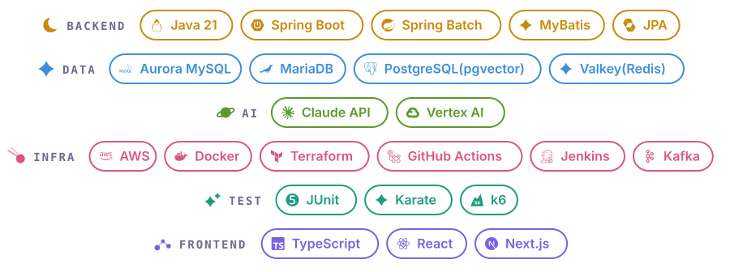
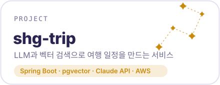
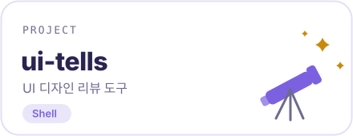
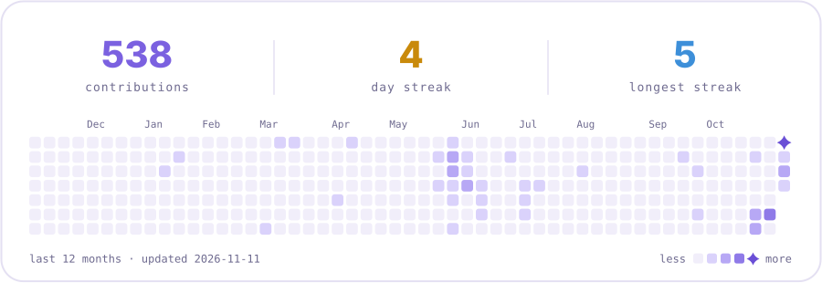

  <picture>
    <source media="(prefers-color-scheme: dark)" srcset="assets/header-night.svg">
    
  </picture>

  <picture>
    <source media="(prefers-color-scheme: dark)" srcset="assets/stack-night.svg">
    
  </picture>

 

  <a href="https://github.com/byunggwan-kim0918/shg-trip-back"><picture><source media="(prefers-color-scheme: dark)" srcset="assets/project-shg-trip-night.svg"></picture></a>
  <a href="https://github.com/byunggwan-kim0918/ui-tells"><picture><source media="(prefers-color-scheme: dark)" srcset="assets/project-ui-tells-night.svg"></picture></a>

 

  <picture>
    <source media="(prefers-color-scheme: dark)" srcset="assets/activity-night.svg">
    
  </picture>

  <picture>
    <source media="(prefers-color-scheme: dark)" srcset="assets/footer-night.svg">
    
  </picture>

